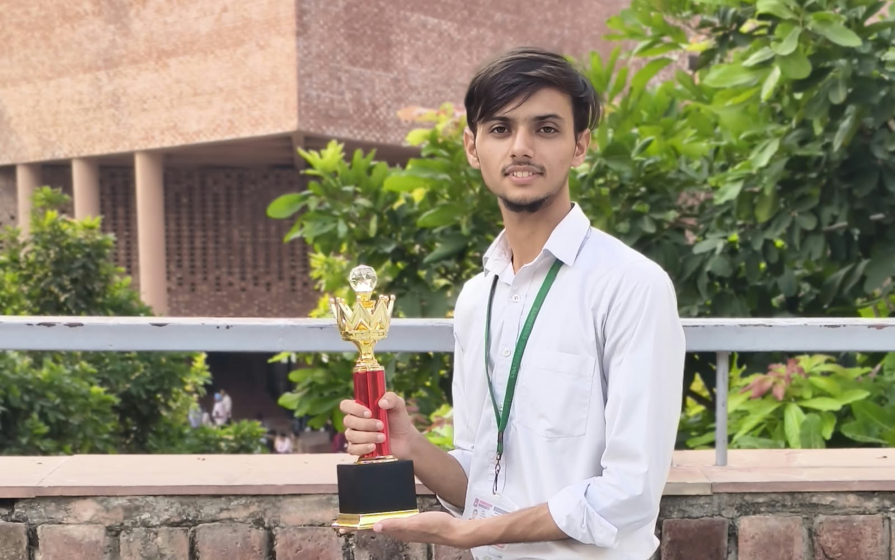

  

---

### 🚀 About Me

<table align="center" border="0" width="100%">
  <tr>
    <td width="65%" valign="top">
      
I am an undergraduate student pursuing <b>BE CSE (Hons.) with a specialization in Artificial Intelligence and Machine Learning (AIML)</b> at <b>Chandigarh University</b> (Expected Graduation: 2028).

      
My core focus lies at the intersection of robust backend engineering and modern artificial intelligence. I build high-performance backend applications, architect clean RESTful APIs, and integrate generative AI capabilities into practical solutions.

      <ul>
        ⚙️ <b>Backend Core:</b> Java, Spring Boot, Spring Security, JWT, MySQL, REST APIs 
        🧠 <b>AI & ML Focus:</b> Python, Machine Learning, Generative AI Ecosystem 
        🎯 <b>Current Mission:</b> Advancing data structures, backend microservices, and AI-powered document intelligence.
      </ul>
    </td>
    <td width="35%" align="center" valign="top">
       
      
    </td>
  </tr>
</table>

---

### 🛠️ Technology Stack

| Category | Technologies & Tools |
| :--- | :--- |
| **Languages** | `` `` `` |
| **Backend & APIs** | `` `` `` `` `` |
| **Databases** | `` |
| **AI / ML Ecosystem** | `` `` `` |
| **Developer Tools** | `` `` `` `` |

---

### 📂 Featured Projects

<table align="center" border="0" width="100%">
  <tr>
    <td width="50%" valign="top">
      <h3>🤖 AI Resume Screener</h3>
      
An intelligent recruitment application under active development designed to parse resumes, match candidate criteria against job requirements, and assist recruiters with automated evaluations.

      
<b>Tech Stack:</b> Java, Spring Boot, Python, Generative AI, MySQL, REST APIs, JWT Authentication.

      

        <code>Under Active Development</code> • 
        <a href="https://github.com/YOUR_GITHUB_USERNAME/AIResumeScreeneer"><b>Repository</b></a>
      

    </td>
    <td width="50%" valign="top">
      <h3>📈 Data Science Career Value Chain</h3>
      
An analytical project exploring the Indian data science career ecosystem, mapping key lifecycle stages from landing entry roles and optimizing compensation to career advancement and leadership success.

      
<b>Focus Areas:</b> Get Hired • Get Paid • Get Promoted • Succeed as a Leader.

      

        <code>Exploratory Data Analysis</code> • 
        <a href="https://github.com/YOUR_GITHUB_USERNAME/PLACEHOLDER_REPO"><b>Repository</b></a>
      

    </td>
  </tr>
</table>

---

### 🏆 Achievements & Honors

<table align="center" border="0" width="100%">
  <tr>
    <td width="40%" align="center" valign="middle">
      
    </td>
    <td width="60%" valign="middle">
      <ul>
        <li>
          🥇 <b>2nd Position – National Level "Build For Bharat" Hackathon</b> 
          Secured runners-up position at Chandigarh University among competitive national entries for building an impactful tech solution.
        </li>
         
        <li>
          🥈 <b>2nd Position – MindForge Coding Competition</b> 
          Demonstrated algorithmic proficiency and problem-solving speed under competitive coding constraints.
        </li>
      </ul>
    </td>
  </tr>
</table>

---

### 📊 GitHub Analytics & Metrics

  
  

---

### 🐍 Contribution Activity

  

---

### 🎯 Current Learning Focus

- **Advanced Data Structures & Algorithms:** Strengthening problem-solving efficiency in Java.
- **Enterprise Backend Architecture:** Implementing secure role-based access control and microservices using Spring Boot & Spring Security.
- **Generative AI Integration:** Exploring LLM orchestration and API pipelines for intelligent applications.

---

### 🌐 Connect With Me

  
  &nbsp;&nbsp;
  
  &nbsp;&nbsp;
  

  

